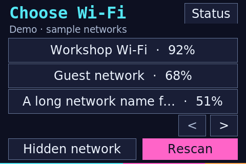
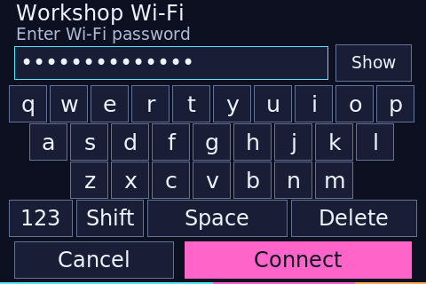
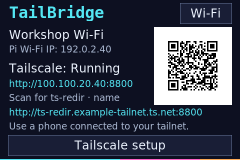
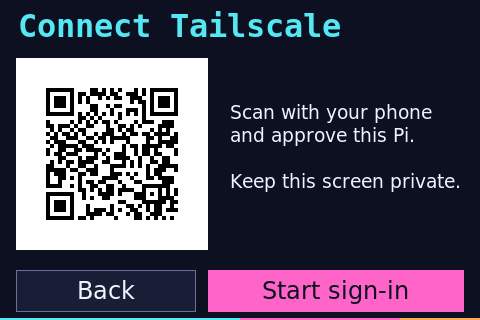

# TailBridge for Raspberry Pi

A touchscreen Wi-Fi appliance with LAN-to-tailnet forwarding through
[ts-redir](https://github.com/apoindevster/ts-redir).

Target: **Raspberry Pi 4 with 2 GB RAM, Raspberry Pi OS
Trixie 64-bit, SunFounder 3.5-inch 480×320 IPS SPI resistive touchscreen**
(MHS35IPS / ST7796U + XPT2046). Physical compatibility and throughput still need
testing on your Pi; see [RESULTS.md](RESULTS.md).

The Pi boots directly into a native Wi-Fi selection screen. A dedicated systemd
service starts Xorg and an unprivileged Python/Tk app; there is no desktop login
manager, shell autologin, Chromium kiosk, or Linux login required on the display.
Linux, NetworkManager and the official Tailscale daemon handle networking.

**ts-redir management stays on `tailscale0`, TCP 8800.** Open its Tailscale IP or
full MagicDNS name from a device allowed by your tailnet policy. There is no additional web account
or LAN management endpoint. LAN clients use selected ports on the Pi's LAN IP to
reach tailnet destinations; they do not need Tailscale themselves.

## Touchscreen preview

Actual 480×320 captures of the native app using **invented networks and URLs**.
These are software previews, not photographs of the physical display. The
enrollment QR below is deliberately fake.

| Choose Wi-Fi | Touch keyboard |
| --- | --- |
|  |  |
| **Connection status and management QR** | **Tailscale enrollment** |
|  |  |

See [all screenshot states and how to regenerate them](artifacts/README.md).

## Install the prepared package

`scripts/install.sh` is the single installation entry point. Every fresh install
includes the first-boot fixes, dark neon theme, app-only display and keyboard
protections, protected Wi-Fi broker, and tailnet-only ts-redir management. No
separate repair or theme-update scripts are needed. Screen blanking is not enabled.

1. Flash **Raspberry Pi OS Trixie 64-bit**. Lite is the intended minimal setup;
   Desktop can also be configured by the installer to boot the appliance service.
   Configure an administrator account and SSH in Raspberry Pi Imager. Keep those
   credentials private. Use Ethernet for the initial install and recovery access.
2. With power disconnected, fit the SunFounder screen. Use a suitable Pi 4 power
   supply. Start from a clean display configuration; do not also run LCD-show's
   installer. It replaces configuration and adds its own startup path.
3. Copy `build/tailbridge-pi-arm64.tar.gz` and its `.sha256` file to the Pi. For
   example, replace the account and address in
   `scp build/tailbridge-pi-arm64.tar.gz* USER@PI_IP:~/`.
4. Over SSH on the Pi:

   ```sh
   sha256sum -c tailbridge-pi-arm64.tar.gz.sha256
   tar -xzf tailbridge-pi-arm64.tar.gz
   cd tailbridge-pi
   sudo ./scripts/install.sh --country US
   sudo reboot
   ```

   Replace `US` with your actual two-letter Wi-Fi regulatory country. Installation
   needs internet access for signed OS packages, Tailscale and the checksum-pinned
   SunFounder overlay. The overlay is downloaded for local installation and is
   excluded from redistributed packages; see [provenance](docs/THIRD-PARTY.md). It checks Pi 4,
   arm64, Trixie, authenticated console login and active SSH recovery before changing
   system settings. Use normal password login in the OS setup; existing autologin
   or custom console commands require correction before installation. It does not reboot until you
   issue the last command. Disconnect HDMI for the first SPI display test.
5. After reboot, verify the running appliance through SSH:

   ```sh
   sudo python3 /opt/tailbridge/scripts/verify_kiosk.py
   ```

## First boot and use

1. **Choose Wi-Fi** opens on every boot, including when a saved connection has
   already connected. Select a network, enter its password using the touch
   keyboard, and tap **Connect**. Hidden networks and open networks are supported.
   WPA2 Personal and WPA3 Personal are supported; enterprise, captive portal and
   legacy Wi-Fi require separate setup. The supplied stylus helps with keyboard
   keys on this small resistive panel.
2. A successful join saves the NetworkManager profile. A failed join requests
   restoration of the previous Wi-Fi connection; a 90-second NetworkManager
   checkpoint also protects against a broker failure. Ethernet is not checkpointed.
3. Open **Status → Tailscale setup → Start sign-in**, scan the QR code with your
   phone and authorize the Pi. Treat that QR as private. If enrollment needs manual
   intervention, run `sudo tailscale up` in your private SSH session, following
   its output. Existing non-default Tailscale options may require the CLI path.
4. The display shows `http://100.x.y.z:8800` and this Pi's full tailnet name, such
   as `http://ts-redir.example-tailnet.ts.net:8800`, once Tailscale is running.
   Open either URL from an authorized tailnet device. Include **`:8800`**; no web
   listener is added on port 80 or 443. Name access requires MagicDNS to be enabled
   and the client to use Tailscale DNS. The HTTP connection travels inside
   Tailscale's encrypted tunnel. Only this device's exact full name and numeric
   address are accepted; short names, arbitrary aliases and other devices' names
   are rejected. Names refresh within 30 seconds after a rename; use the IP if
   name resolution is unavailable. A name too long for the display is explicitly
   shortened, with a prompt to scan the QR or use the complete IP URL above it.
   The status-page **QR opens ts-redir directly in your phone's browser**. It
   contains only the HTTP management URL, with port 8800, and prefers the full
   tailnet name. If the name is unavailable or too dense for this small QR, it
   uses the Tailscale IP; the caption identifies which. Your phone must already
   be connected to the tailnet and allowed to reach the Pi. No sign-in or
   credentials are encoded in this QR. The enrollment QR remains on Tailscale
   setup. Status QR codes disappear if Tailscale is not Running or status cannot
   be read. Unchanged polls leave the code steady for scanning.
5. In ts-redir choose a tailnet peer and create a rule, for example:

   | Field | Example |
   | --- | --- |
   | Protocol | TCP |
   | Ingress interface | `wlan0` (or `eth0` for wired clients) |
   | Match IP | The Pi's LAN IP, e.g. `192.168.1.50` |
   | Match port | `8080` |
   | Target IP | The peer's `100.x.y.z` address |
   | Target port | `80` |

   A LAN client can now open `http://192.168.1.50:8080`. The peer sees the Pi's
   Tailscale identity, so your tailnet policy must allow the Pi to reach it. Reserve
   the Pi's LAN address in DHCP; a changed address requires updating rules. Use a
   different ingress port than SSH or management (22 and 8800). Rules persist
   across reboots, up to 64. Removing a rule prevents new matches; already tracked
   connections may continue until they close or expire.

Management access should be restricted in your **Tailscale grants/ACLs** to the
people/devices that administer this Pi. Anyone permitted to access its TCP 8800
can manage redirects. LAN clients can use any redirect you expose on their
interface; this does not authenticate individual LAN clients.

See Tailscale's [MagicDNS documentation](https://tailscale.com/docs/features/magicdns)
for naming and client DNS configuration. This integration does not rename the Pi,
enable MagicDNS in the admin console, or change tailnet access policy.

## Recovery and diagnostics

The touchscreen uses a dark neon theme and hosts only TailBridge. Its production
window cannot be closed to reach a desktop or shell. Administration remains behind
an authenticated SSH or console login; no desktop session automatically logs in.

For reinstallation, extract a new bundle into an empty directory and use the same
`scripts/install.sh --country YOUR_COUNTRY` command, then reboot when ready. This
reuses the original recovery backup and preserves `/etc/tailbridge/environment`,
network profiles, Tailscale identity and redirect state. It replaces installed
code and removes the retired patch entry points; it is not a live-update or
automatic rollback mechanism. Keep the previous bundle or an SD image for a
version rollback. A previously recovered installation requires archiving its
old recovery backup before installing again, as reported by the installer.

SSH is kept available. Ethernet remains an independent recovery route. The
installer saves original boot configuration, changed files, boot target and the
previous IPv4 forwarding and keyboard SysRq settings under `/var/lib/tailbridge/install-backup`.

```sh
sudo tailbridge-doctor
sudo journalctl -u tailbridge-display -b --no-pager
# Restore original boot/display files and boot target, then reboot:
sudo /opt/tailbridge/scripts/recover.sh
sudo reboot
```

Recovery removes only TailBridge's two nftables tables and services. Installed
packages, Wi-Fi profiles, Tailscale identity and saved redirect rules are retained.
If the framebuffer is present but detection fails, set `FRAMEBUFFER=/dev/fb1` to
the correct device in `/etc/tailbridge/environment`, then restart
`tailbridge-display`. `tailbridge-doctor` lists framebuffer names. Touch calibration
starts with SunFounder's landscape values in `/opt/tailbridge/packaging/xorg.conf.in`;
calibration and corner alignment must be checked on the physical screen.

If SSH is unavailable, power down and mount the SD card on another Linux computer.
Restore `boot/firmware/config.txt` from the corresponding file below
`var/lib/tailbridge/install-backup/original/` on the root partition (the firmware
partition's file is `config.txt`). Temporarily add `systemd.unit=rescue.target` to
the existing single line in the firmware partition's `cmdline.txt` for local
recovery, removing it afterwards. Preserve your original SD image as the simplest
full rollback. Do not overwrite or share NetworkManager or Tailscale state files.

## Build and development

The ready-to-copy artifact is `build/tailbridge-pi-arm64.tar.gz`. Rebuild on Linux
with Python 3, Git, curl, a C compiler for Go's race detector, and Go with automatic
toolchain downloads enabled:

```sh
./scripts/build.sh
python3 -m unittest discover -s tests -v
python3 -m tailbridge.ui --demo --windowed
```

The build pins ts-redir, applies the reviewed integration in its own disposable
cache, tests it with the Go race detector, and cross-compiles a static arm64 binary.
It assembles a clean bundle and runs the Python tests against that bundle before
publishing it. These include temporary-root installation, repeat installation and
configuration recovery; an older build cannot retain retired scripts in the package.
Embedded Pico CSS is hash-checked at build time, and the vendor overlay at install
time. Neither this build nor
demo mode changes host networking. Python test dependencies on Debian are
`python3-tk python3-dbus python3-qrcode`; UI tests also need an X display.
For screenshot-level QR verification, install Pillow and zxing-cpp in a development
virtual environment alongside qrcode, then run
`.venv/bin/python tests/ui_smoke.py --decode-qr`. This decodes only synthetic
captures; the decoder dependencies are not installed on the appliance.

## GitHub builds and contributing

Push this source repository to GitHub to run **Build and verify** on pushes and
pull requests. The workflow checks publishable files and secrets, tests Python
and Go, captures the native UI in Xvfb, decodes its synthetic QR codes and builds
the Linux arm64 install package. Download `tailbridge-pi-arm64` from the successful
run's **Actions → Artifacts**, unzip the GitHub artifact, and use the enclosed
`.tar.gz` and checksum with the installation steps above. The separate
`synthetic-ui-captures` artifact contains that run's screenshots. Artifacts expire
after 30 days; a maintainer can attach verified packages to a release manually.

CI does not install on a Pi or perform physical, direct/DERP or soak tests.
See [CONTRIBUTING.md](CONTRIBUTING.md) for local checks and
[publication notes](docs/PUBLISHING.md) for the audit scope and first-push setup.
Report vulnerabilities through [SECURITY.md](SECURITY.md).

Original TailBridge code is [MIT licensed](LICENSE). Upstream code and assets keep
their own notices; the release bundle includes ts-redir and Go dependency licenses.

See [architecture and security](docs/SECURITY.md), [hardware test checklist](docs/TESTING.md),
[third-party provenance](docs/THIRD-PARTY.md), and [implementation plan](PLAN.md).
